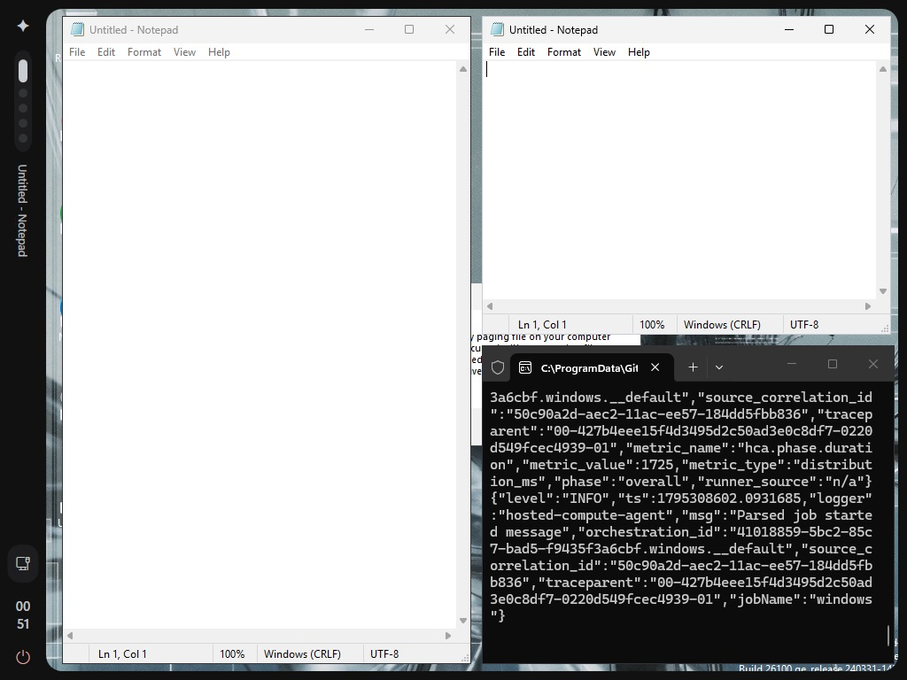
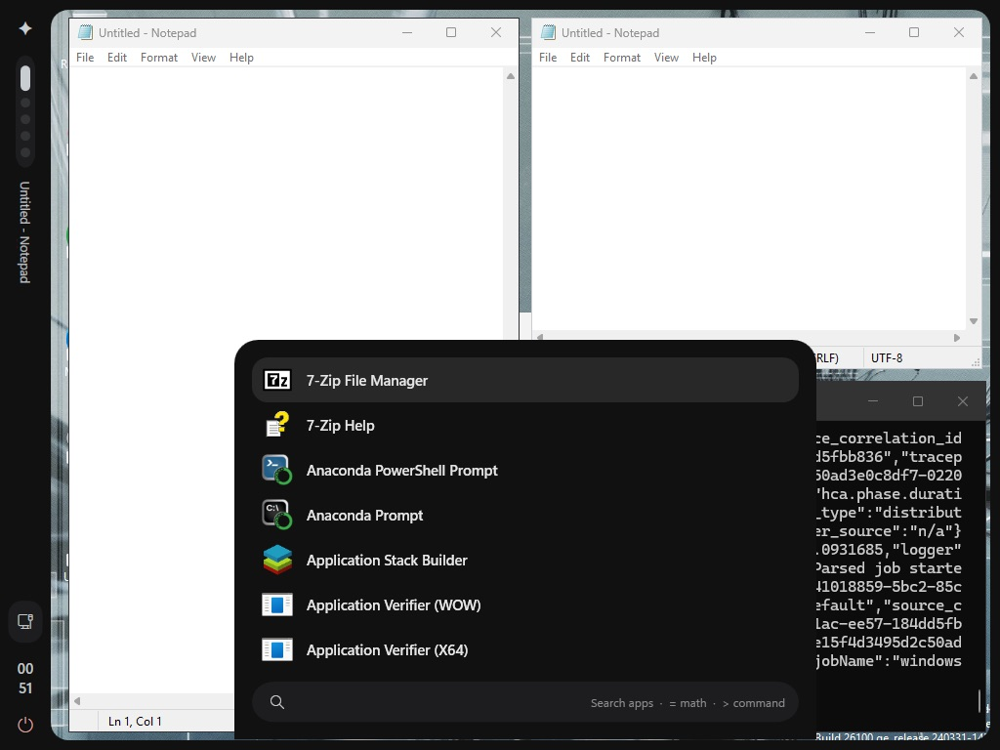
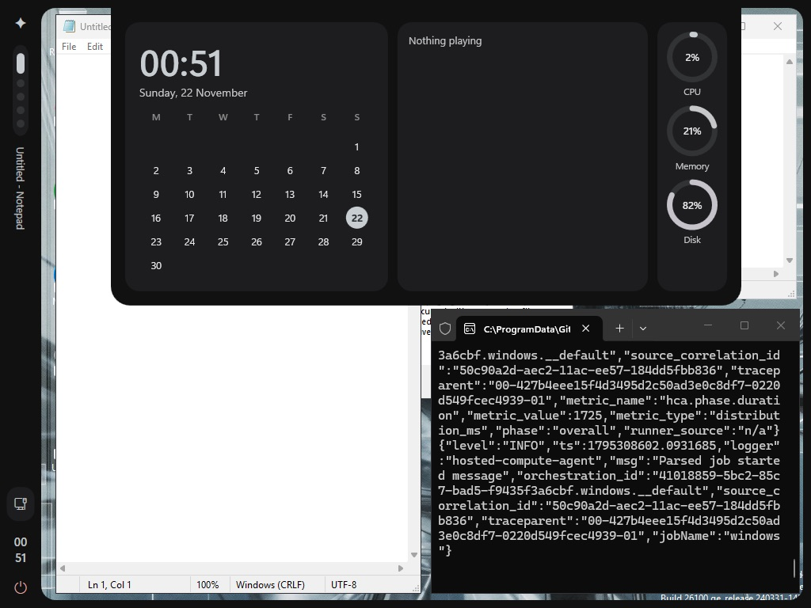
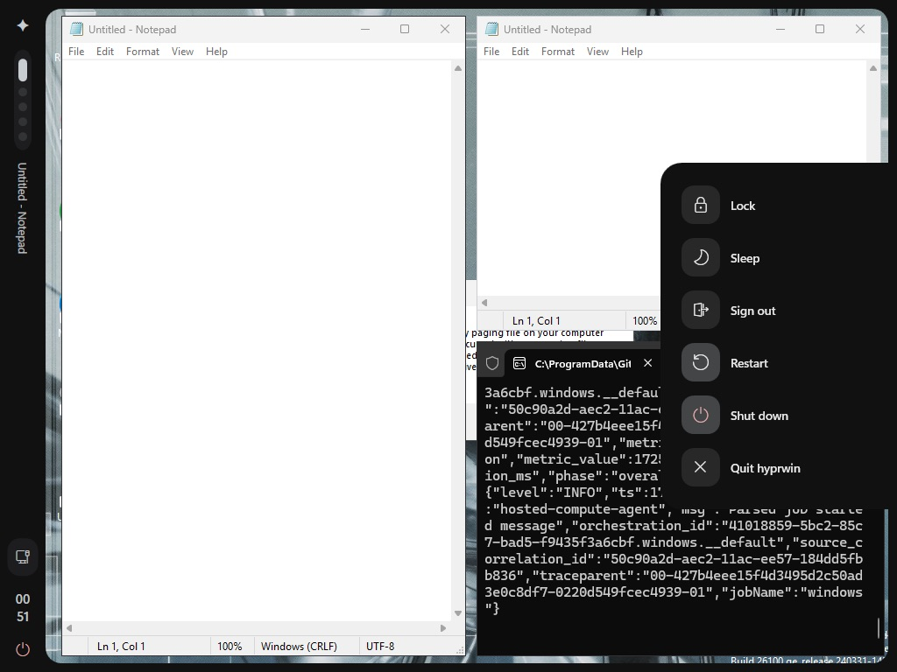

# hyprwin

Hyprland-style tiling for Windows 10/11: the Windows side of hyprmac. Same config (`hyprland.conf`
or Hyprland Lua `hyprland.lua`), same dispatchers, same `rice` command. The core (config parser,
Lua shim, dwindle/master layouts, workspaces, rices) is a C# port of the Swift core, with the same
tests; the `hl.*` Lua shim is literally the same file (`../shared/hl-prelude.lua`).



> Status: 0.2.0, early. Core tests pass on macOS and Windows; CI starts it on a Windows runner.
> It has not been used day-to-day on a real desktop yet.

## Install

In PowerShell (no admin, nothing else to install):

```powershell
irm https://kelus.org/hyprwin.ps1 | iex
```

Options: `& ([scriptblock]::Create((irm https://kelus.org/hyprwin.ps1))) -Startup -Start` (start with
Windows, start now), `-Uninstall`. It installs to `%LOCALAPPDATA%\Programs\hyprwin`, adds a Start menu
entry and puts `hyprwinctl` on PATH. Run it again to update.

Build it yourself instead (needs the .NET 10 SDK):

```powershell
winget install Microsoft.DotNet.SDK.10
.\publish.ps1              # -> dist\hyprwin-win-x64\hyprwin.exe + hyprwinctl.exe
```

(`./publish.sh` builds the same thing from macOS or Linux.)

Run `hyprwin.exe`: a tray icon shows the workspace number. Start with Windows: put a shortcut to
`hyprwin.exe` in `shell:startup`. Put the folder on PATH for `hyprwinctl`.

## Config

`%USERPROFILE%\.config\hyprwin\hyprland.conf`, created on first run. Saved changes reload
automatically. `hyprwinctl check-config` shows what loaded, what was ignored and which binds were
skipped. Everything in the main README's config section applies, with these differences:

- `SUPER` is the Windows key. Windows reserves many Win combos (Win+L, Win+D, Win+1..9), so the
  default config uses `ALT`. `hyprwin { super = alt }` remaps SUPER binds, like on the Mac.
- Commands run with `cmd.exe /c`. Start GUI apps with `start "" app.exe`.
- `class:` in window rules matches the process name (`chrome`, `WindowsTerminal`) or the window
  class (`Chrome_WidgetWin_1`). `hyprwinctl clients` shows both.
- Borders: Windows 11 colors the real window border (first color of `col.active_border` /
  `col.inactive_border`); `border_size` can't change its width. Rounded corners follow `rounding`.
  Windows 10 has no colored borders.

## Shell

hyprwin comes with its own desktop shell, inspired by Caelestia's look (original code):

- **Bar** on the left: launcher button, workspace pills (click to switch), the active window's title,
  network and battery, clock (click for the dashboard), power (click for the session menu).
- **Frame** around the screen in the bar's color; tiled windows sit inside it.
- **Launcher** grows out of the bottom edge (`Alt+D`): installed apps with icons; start with `=` for
  math or `>` to run a command.
- **Dashboard** grows out of the top (`Alt+Shift+D`): clock, calendar, now playing (Spotify, browsers,
  Media Player) with controls, CPU / memory / disk.
- **Session** menu on the right (`Alt+Shift+P`): lock, sleep, sign out, restart, shut down (restart
  and shut down need a second click), quit hyprwin.
- **Colors** come from your wallpaper (Material-style dark scheme) and follow it when it changes; window
  borders use them too unless the config sets `col.active_border`.
- The **taskbar** auto-hides while hyprwin runs and comes back when it quits.

| Launcher | Dashboard | Session |
|---|---|---|
|  |  |  |

```ini
hyprwin {
    shell = true          # false = tiling only
    hide_taskbar = true
    scheme = auto         # or a seed color: rgb(89b4fa)
}
bind = ALT, D, global, shell:launcher      # also: shell:dashboard, shell:session
```

Caelestia-style binds (`global, caelestia:launcher`) work too.

## How it works

- Windows of hidden workspaces are moved beyond your monitors. They stay in the taskbar and
  Alt-Tab; picking one switches to its workspace.
- Windows of apps running as administrator can't be moved by a normal program; they're left alone.
- Minimized windows and windows on other virtual desktops leave the layout until they come back.
- Dragging a tiled window snaps it back.
- Quitting (tray > Quit, `hyprwinctl dispatch exit`) puts every window back on screen and resets
  border colors.

## hyprwinctl

```powershell
hyprwinctl dispatch workspace 3
hyprwinctl -j clients
hyprwinctl activewindow | workspaces | monitors | binds | configerrors | skippedbinds | reload | version
hyprwinctl listen                    # events: workspace>>2, activewindow>>chrome,Title ...
hyprwinctl rice install https://github.com/43PR/dotfiles
hyprwinctl rice use 43pr             # or tray > Rice
hyprwinctl rice off
```

Pipes: `\\.\pipe\hyprwin-<user>` and `\\.\pipe\hyprwin-events-<user>`, current user only.

## Rices on Windows

Same as on the Mac (`hyprwinctl rice help`), with Windows locations: `nvim` goes to
`%LOCALAPPDATA%\nvim`, `alacritty`/`helix`/`spicetify`/`yazi` to `%APPDATA%`, `wezterm`,
`fastfetch`, `starship.toml` and `hypr` to `%USERPROFILE%\.config`. Folders are linked with
directory junctions (no admin needed); single files are symlinked when Developer Mode allows it,
otherwise copied. kitty, ghostty, cava and the Linux desktop parts (Quickshell, Waybar, rofi, GTK)
are skipped.

Linux tools get `.cmd` stand-ins in `%LOCALAPPDATA%\hyprwin\shims` when missing: `hyprctl` ->
`hyprwinctl`, `wl-copy` -> `clip`, `wl-paste` -> `Get-Clipboard`, `notify-send` -> balloon
notification, `xdg-open` -> `start`, `thunar`/`nautilus`/`dolphin` -> Explorer, `kitty`/`alacritty`
-> the real app or Windows Terminal, `brave`/`firefox`/`chrome` -> installed browser, `rofi` ->
Start menu search, `hyprlock` -> lock screen. Binds needing anything else (Quickshell `qs`,
`grim`, `cliphist`, `pgrep`, ...) are not registered.

Rice scripts are usually POSIX shell; they run through `cmd.exe`, so many won't work as-is.

## Layout

- `src/Hyprwin.Core`: platform-free core (net10.0), tested on any OS.
- `src/Hyprwin`: the window manager (WinForms tray app; Win32 + DWM).
- `src/hyprwinctl`: console CLI.
- `tests/Hyprwin.Core.Tests`: xUnit, same cases as the Swift tests.
